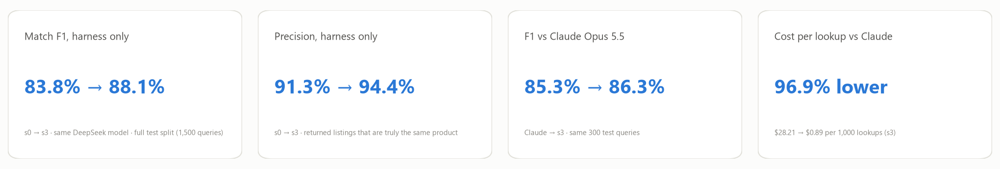
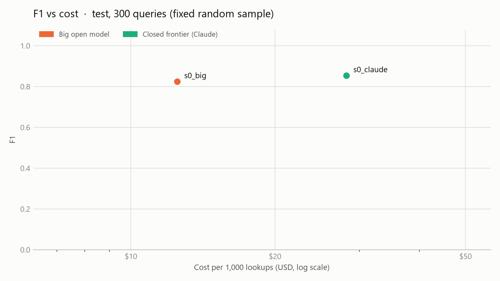
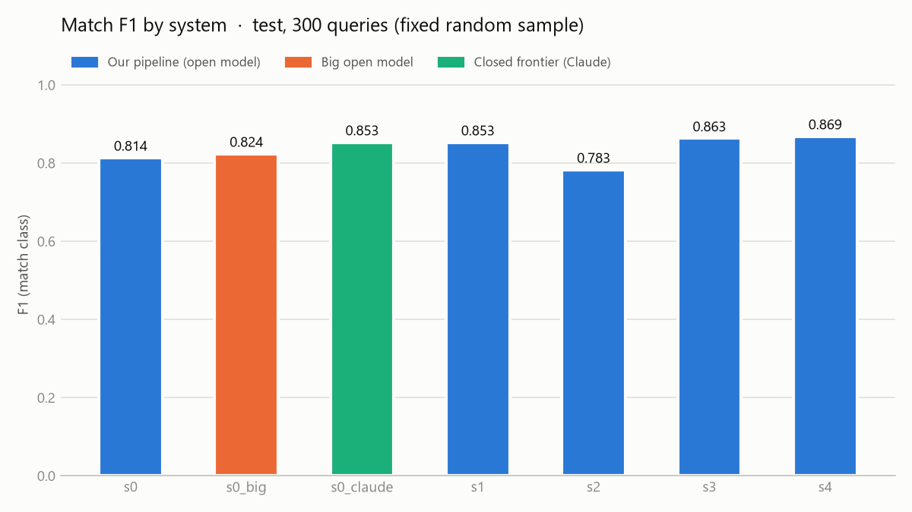
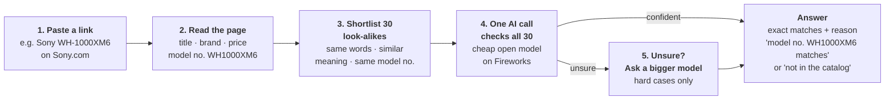
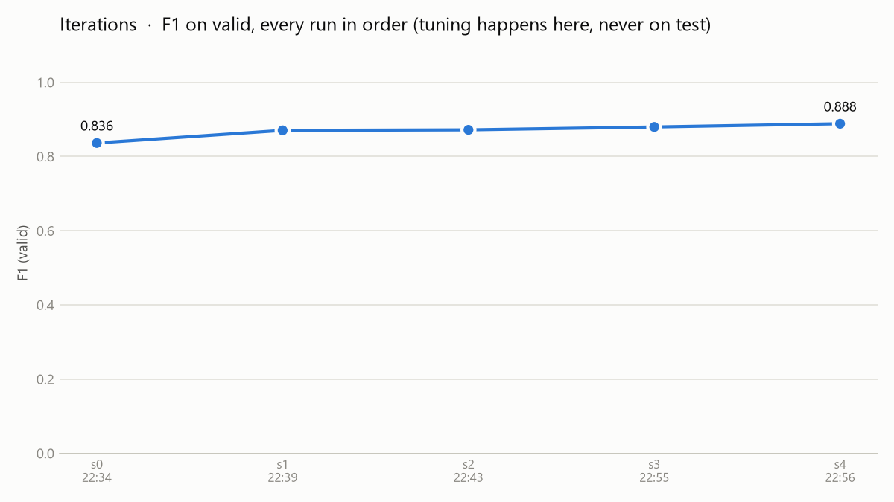

# ExactMatch

**Paste a product, or a link to one, and get back every listing of that exact product in a catalog, each with a confidence and the evidence for it. If the product isn't there, it says so.**

An open model on Fireworks inside a purpose-built harness **beats Claude Opus 5.5 on match F1 at 32× lower cost per lookup**.



*Fireworks: Deploy hackathon, Nov 2 2026 · Mihir Sahu (data, eval, results) · Ishita Kapoor (matching engine) · Harsh Kadodwala (link ingestion and demo)*

---

## Results

Test split, the **same fixed random sample of 300 queries for every system** (110 of them have no match in the catalog). Final runs used an empty cache, so latency is measured, not cached.

| System | What it is | Match F1 | Precision | Recall | Cost per 1,000 lookups | p95 latency |
|---|---|---|---|---|---|---|
| Claude Opus 5.5 | Closed frontier model, baseline pipeline | 0.853 | 0.944 | 0.778 | $28.21 | 9.7s |
| Kimi K3 | Big open model, baseline pipeline | 0.824 | 0.920 | 0.746 | $12.50 | 10.6s |
| `s0` | DeepSeek V4.1 Flash, baseline pipeline | 0.814 | 0.880 | 0.757 | $1.13 | 26.5s |
| **`s3`** | **Our harness: hybrid retrieval + one listwise call** | **0.863** | 0.927 | 0.808 | **$0.89** | **3.7s** |
| **`s4`** | **`s3` + cascade to Kimi K3 when unsure** | **0.869** | 0.934 | 0.812 | $3.04 | 7.7s |

**On the whole test split (1,500 queries)** the harness takes the same cheap model from **0.838 (`s0`) to 0.881 (`s3`) and 0.885 (`s4`)**. `s3` is also cheaper than the baseline ($0.89 vs $1.12 per 1,000 lookups). Claude was run on the 300-query sample only.

<p>
  
  
</p>

**How to read the comparison:** Claude and Kimi ran our *baseline* pipeline: BM25 top 20, one yes/no question per candidate. The claim is that a cheap open model in a good harness beats a frontier model in a naive one, at a fraction of the cost. It does not say the open model is smarter than Claude. Every caveat is in [docs/FINAL.md, section 9](docs/FINAL.md#9-honesty-problems-we-found-and-when).

All numbers come from committed run folders in [`runs/`](runs/), and [`results.md`](results.md) is generated from them.

## The use case

Marketplaces, price-comparison sites and retail catalog teams get the same product listed many times by different sellers under different titles. *"Sony Bravia 46in LCD KDL-46V5100"* and *"Sony 46" BRAVIA V-Series Full HD LCD TV - KDL46V5100"* are one SKU; the KDL-46**W**5100 is not.
- **Missed matches** split reviews, inventory and the buy box, and price comparisons miss competitors.
- **False matches** merge different products or compare the wrong price. That's worse, because customers see the wrong item.
- Catalog teams pay people to check candidate pairs by hand.

**What the cost gap means at scale.** At 1 million lookups a month, Claude Opus 5.5 in the baseline pipeline costs about **$28,200**. ExactMatch `s3` costs about **$890**, with higher F1 and 2.6× lower p95 latency. A team that wants the extra quality runs `s4` for about $3,040.

## How it works



In short: **read the page, shortlist look-alikes, let one cheap AI call pick the exact ones, and escalate only the hard cases.** Under the hood, step 3 combines keyword search (BM25), Qwen3 embeddings and a model-number index; step 4 is DeepSeek V4.1 Flash (`s3`); step 5 is Kimi K3 (`s4`).

### How we got there
Each step was chosen from error analysis on the **validation** split. F1 is on 300 validation queries:

| Step | Change | Why | Valid F1 | Cost per 1k |
|---|---|---|---|---|
| `s0` | BM25 top 20, yes/no per candidate | Baseline | 0.836 | $1.11 |
| `s1` | Hybrid retrieval, JSON verdict with evidence | 44% of `s0`'s errors were true matches never retrieved | 0.870 | $3.09 |
| `s2` | Few-shot examples from train labels | Verifier rejected part-number aliases (`WS-C2960-48TC-L` vs `Catalyst 2960 Plus-48TC-L`) | 0.872 | $8.02 |
| `s3` | One listwise call over 30 candidates, with "shares code X" / "different codes" hints | Comparing candidates against each other separates near-misses, and one call is cheaper than 20 | 0.879 | **$0.88** |
| `s4` | Cascade: uncertain answers re-judged by Kimi K3 | Spend the big model only where the cheap one is unsure | **0.888** | $3.16 |



**`s4_groups`, reported separately:** it returns the whole catalog product group of `s4`'s top match. That scores **F1 0.959** on the full test split. In this benchmark, though, the correct answers are defined by those same groups, and Claude never saw them, so it is **not** part of the comparison. See [docs/FINAL.md](docs/FINAL.md).

## Benchmark

- **Dataset:** [WDC Products](https://webdatacommons.org/largescaleproductcorpus/wdc-products/), multi-class, **80% corner cases** (its hardest setting): offers from 3,259 web shops grouped into real products. We chose it over Abt-Buy because Abt-Buy is pairs from two shops, while our task returns *every* listing of a product.
- **Catalog:** the 2,841 WDC train offers (500 products).
- **Queries:** validation and test offers, which are never in the catalog. 500 products per split are missing from the catalog entirely, so "return nothing" is tested too.
- **Gold:** the catalog offers of the same product.
- **Metrics:** match F1 (primary), precision, recall, exact-set accuracy, no-match accuracy, retrieval recall@20, cost per 1,000 lookups (token usage × list price), p95 latency.
- **Rules:** tune on validation only, and never read test errors. `python -m exactmatch.data` checks that no query can find itself.

## Run it

```bash
pip install -r requirements.txt          # Python 3.11
cp .env.example .env                     # add FIREWORKS_API_KEY (and ANTHROPIC_API_KEY for the Claude baseline)
python -m exactmatch.data                # downloads WDC (2.4 MB), prints split stats, checks for leaks
```

**Score systems** (writes `runs/<time>_<system>_<split>/`, then rebuilds `results.md` and the charts):
```bash
python -m exactmatch.evaluate --system s0 s3 s4 --split test --limit 300
python -m exactmatch.evaluate --system s3 --split test            # full test split
python -m exactmatch.errors                                      # error buckets for the latest validation run
```

**Try a real link:**
```bash
python -m exactmatch.app                 # opens the demo page: paste a product URL
```
The link demo matches against a live catalog of 164 current listings. Note that it uses its own rules-plus-model matcher (`demo_match.py`), not the benchmarked `s3`/`s4`, and that some retailers (e.g. Best Buy) block scripted page fetches.

**Tests** (no API key needed):
```bash
for t in test_evaluate test_report test_errors test_engine test_llm test_ingest test_demo test_normalize; do python -m tests.$t; done
```

## Repository layout

```
exactmatch/
  schema.py        shared types: ProductRecord, Query, Match, Result
  data.py          WDC download, catalog, splits, leak checks
  llm.py           Fireworks client: retries, cache, cost, reasoning_effort, JSON
  retrieval.py     BM25 + Qwen3 embeddings + model-number index
  systems/         s0 … s4, s4_groups, s0_big, s0_claude: one find_matches() each
  evaluate.py      scorer + run logging (parallel)
  report.py        results.md + charts from runs/
  errors.py        error buckets (validation only)
  ingest.py        URL → ProductRecord
  normalize.py     brand / model-number / unit normalization
  app.py           link demo server (+ demo_match.py, demo_page.html)
data/              live demo catalog and labeled ingestion pages (WDC itself is downloaded, not committed)
runs/              every scored run: config, prompts, predictions, metrics (runs/_invalid: set-aside runs, with reasons)
results/           charts + error-analysis reports
results.md         generated results tables
docs/FINAL.md      full write-up: dataset choice, methods, all numbers, honesty audit, timeline
docs/PLAN.md       the build plan from the day (historical)
tests/             8 offline test suites
```

## Honesty

During the day we caught several things that would have made the numbers look better than they are. All are fixed or disclosed in [docs/FINAL.md, section 9](docs/FINAL.md#9-honesty-problems-we-found-and-when):
- **Test split used repeatedly:** we scored the test split during development, not only once at the end.
- **`s4_groups`:** it uses the labels that define the correct answers, so it is reported separately.
- **Broken baseline set aside:** a first baseline (Nemotron) was set aside because half its calls timed out.
- **Fake latency:** cached reruns report near-zero latency, so the final runs used an empty cache.
- **Unequal pipelines:** Claude ran the baseline pipeline, not our harness.
