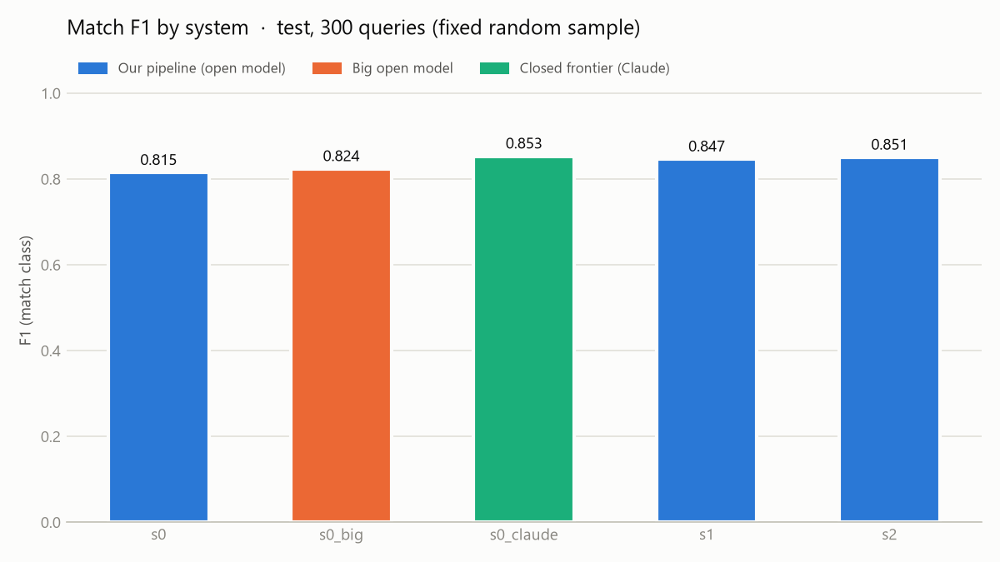
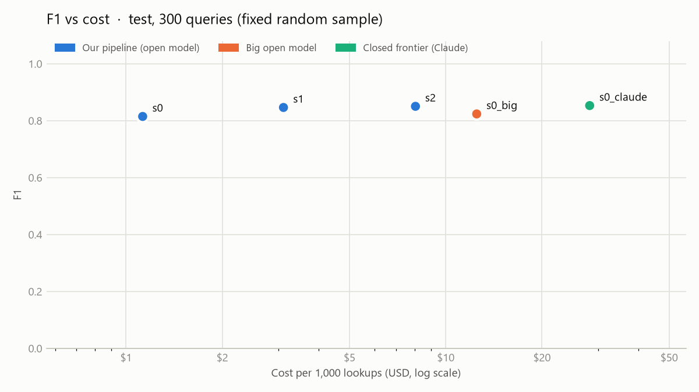
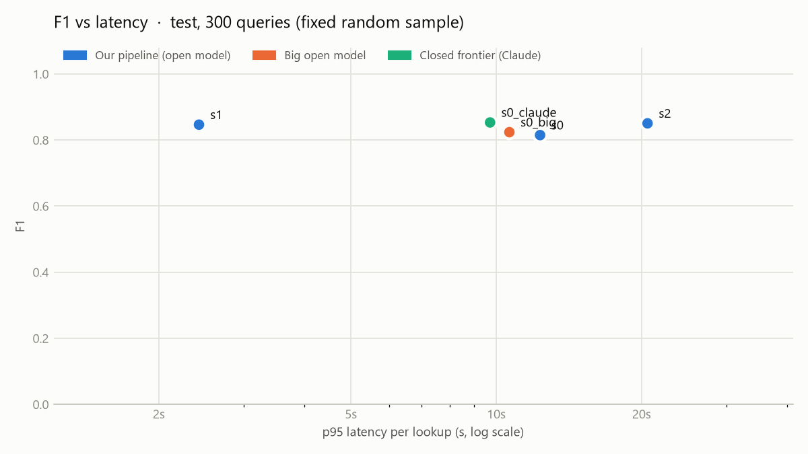
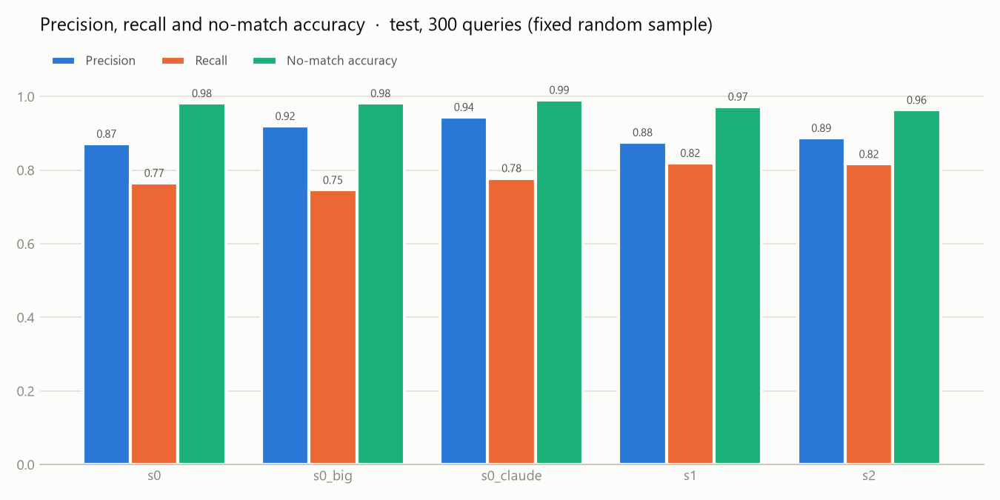
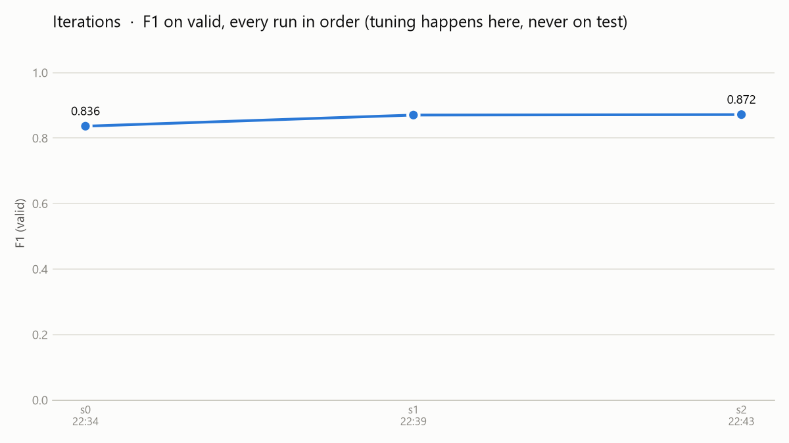

# Results

_Generated by `python -m exactmatch.report` at 2026-11-02 14:55. Do not edit by hand._

**Headline (test, 300 queries):** best system of ours `s2` reaches F1 0.851 vs Claude Opus 5.5 at 0.853 (99.7% of its F1) at 4x lower cost per lookup.

## Charts

## test (random sample of 300)

| System | Queries (no match) | F1 | ΔF1 vs s0 | Precision | Recall | No-match acc | Recall@k | False / missed | Cost per 1k | p95 latency | Errors | Run |
|---|---|---|---|---|---|---|---|---|---|---|---|---|
| `s0` | 300 (110) | **0.815** | – | 0.872 | 0.765 | 0.982 | 0.863 @20 | 123 / 256 | $1.127 | 12.33s | 0 | `20261102-144758_s0_test_n300` |
| `s0_big` | 300 (110) | **0.824** | +0.009 | 0.920 | 0.746 | 0.982 | 0.863 @20 | 71 / 277 | $12.503 | 10.65s | 0 | `20261102-134446_s0_big_test_n300` |
| `s0_claude` | 300 (110) | **0.853** | +0.038 | 0.944 | 0.778 | 0.991 | 0.863 @20 | 50 / 242 | $28.208 | 9.71s | 0 | `20261102-134500_s0_claude_test_n300` |
| `s1` | 300 (110) | **0.847** | +0.032 | 0.876 | 0.819 | 0.973 | 0.894 @20 | 127 / 197 | $3.108 | 2.42s | 0 | `20261102-145136_s1_test_n300` |
| `s2` | 300 (110) | **0.851** | +0.036 | 0.887 | 0.817 | 0.964 | 0.894 @20 | 113 / 200 | $8.043 | 20.58s | 0 | `20261102-145453_s2_test_n300` |

## valid (random sample of 300)

| System | Queries (no match) | F1 | ΔF1 vs s0 | Precision | Recall | No-match acc | Recall@k | False / missed | Cost per 1k | p95 latency | Errors | Run |
|---|---|---|---|---|---|---|---|---|---|---|---|---|
| `s0` | 300 (111) | **0.836** | – | 0.920 | 0.766 | 1.000 | 0.869 @20 | 73 / 257 | $1.110 | 5.06s | 1 | `20261102-223456_s0_valid_n300` |
| `s1` | 300 (111) | **0.870** | +0.034 | 0.931 | 0.817 | 0.991 | 0.922 @20 | 67 / 201 | $3.087 | 0.12s | 0 | `20261102-223926_s1_valid_n300` |
| `s2` | 300 (111) | **0.872** | +0.035 | 0.933 | 0.818 | 0.991 | 0.925 @20 | 65 / 200 | $8.022 | 6.32s | 0 | `20261102-224307_s2_valid_n300` |

Reproduce a row: `python -m exactmatch.evaluate --system <system> --split <split> [--limit N]`.
